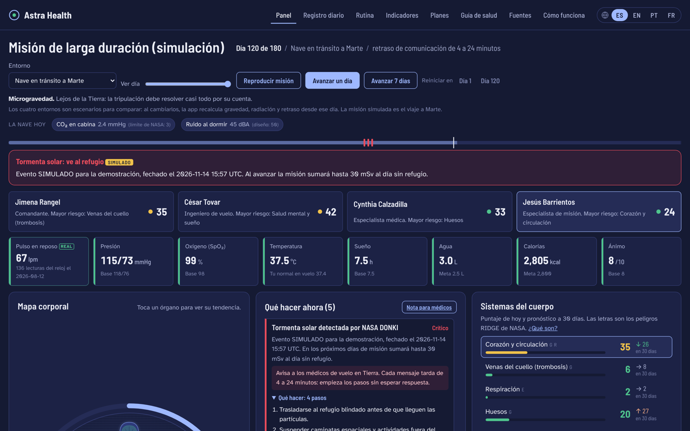
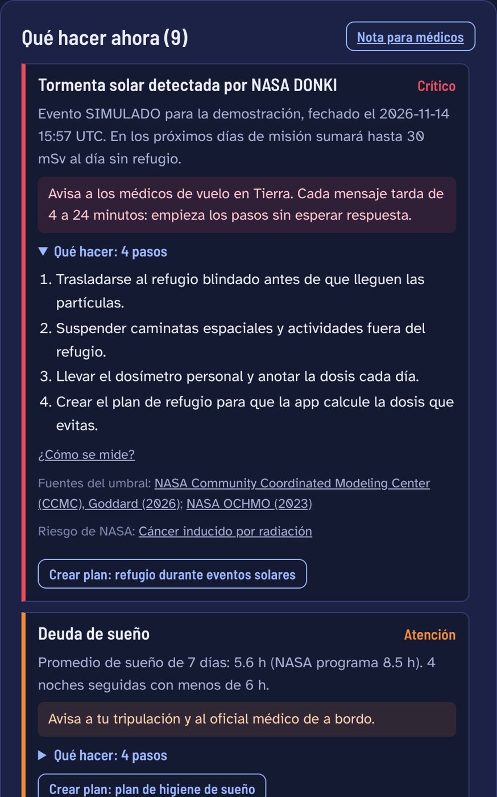
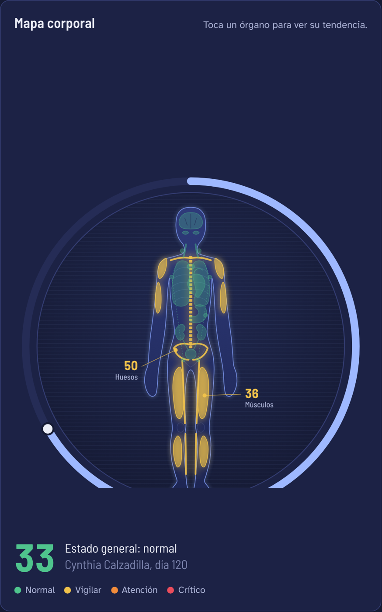

# Astra Health

**Monitorización de salud para misiones espaciales de larga duración.**
NASA Space Apps Challenge 2026 — Sede Ciudad de México.

Una tripulación registra sus indicadores, la aplicación los compara contra **la línea base de
cada persona** —no contra una tabla de población— y cuando algo se desvía dice qué hacer,
quién tiene que actuar y cuánto va a tardar la Tierra en contestar.



> **In English.** Astra Health is a health-monitoring app for long-duration spaceflight. It
> collects daily indicators, scores risk per body system against each crew member's own
> baseline, and turns that into protocols that state who must act and how long Earth will
> take to reply. Every threshold is cited from published NASA and clinical sources. Live
> solar events come from NASA DONKI. The interface ships in Spanish, English, Portuguese
> and French. Documentation below is in Spanish; the code and the in-app Sources page carry
> the full reference list.

---

## Índice

1. [El reto y cómo se responde](#1-el-reto-y-cómo-se-responde)
2. [El ciclo cerrado](#2-el-ciclo-cerrado)
3. [El mismo problema, en la Tierra](#3-el-mismo-problema-en-la-tierra)
4. [Los 17 indicadores](#4-los-17-indicadores)
5. [Cómo se calcula el riesgo](#5-cómo-se-calcula-el-riesgo)
6. [Los protocolos: quién actúa](#6-los-protocolos-quién-actúa)
7. [La tripulación como sistema](#7-la-tripulación-como-sistema)
8. [Las nueve páginas, una por una](#8-las-nueve-páginas-una-por-una)
9. [Datos reales y datos simulados](#9-datos-reales-y-datos-simulados)
10. [NASA DONKI en la mecánica](#10-nasa-donki-en-la-mecánica)
11. [Los cuatro entornos](#11-los-cuatro-entornos)
12. [Rutina y hábitos](#12-rutina-y-hábitos)
13. [Cuatro idiomas](#13-cuatro-idiomas)
14. [Arquitectura](#14-arquitectura)
15. [Instalación](#15-instalación)
16. [Fuentes](#16-fuentes)
17. [Alcance y límites](#17-alcance-y-límites)
18. [Créditos y declaración de uso de IA](#18-créditos-y-declaración-de-uso-de-ia)

---

## 1. El reto y cómo se responde

> Las misiones de larga duración exponen a los astronautas a la radiación espacial, el
> aislamiento y el confinamiento, la gravedad alterada y un entorno cerrado y hostil, lo que
> puede provocar cambios en el sistema inmunitario, pérdida ósea, eventos cardiovasculares y
> problemas de salud mental. **En misiones largas, los astronautas son en gran medida
> responsables de detectar estos cambios en sí mismos.** El reto consiste en desarrollar un
> software de monitorización de la salud que recopile indicadores de salud y permita a los
> astronautas evaluar su estado de salud y actuar en consecuencia.

Esa frase resaltada es el eje del diseño. En un viaje a Marte un mensaje tarda hasta 24
minutos en llegar a la Tierra, así que «pregúntale al médico de vuelo» no es una respuesta
utilizable. Por eso **cada protocolo de esta aplicación dice quién actúa** —tú, la
tripulación o tierra— y lo cruza con el retraso de comunicación del entorno.

### Los cuatro efectos que nombra el enunciado

| Lo que pide el reto | Dónde está |
|---|---|
| Cambios en el sistema inmunitario | Sistema **inmune y radiación**: fiebre contra la línea base en vuelo, erupciones por reactivación viral, dosis acumulada |
| Pérdida ósea | Sistema **huesos**: adherencia al ejercicio de resistencia contra la meta de NASA, con la pérdida de 1 a 1.5 % al mes como referencia |
| Eventos cardiovasculares | Sistemas **corazón y circulación** y **venas del cuello**: pulso, presión, prueba de ponerse de pie, ultrasonido de la vena yugular |
| Problemas de salud mental | Sistema **salud mental y sueño**: sueño, ánimo, estrés, prueba de reacción PVT-B y los tres indicadores de aislamiento |

### Los cinco peligros de NASA (marco RIDGE)

| Peligro | Qué lo mide |
|---|---|
| **R**adiación | dosis diaria y acumulada, límite de 600 mSv de carrera y 250 mSv por evento, eventos solares reales de NASA DONKI |
| **I**slamiento y confinamiento | días sin contacto personal, relación con la tripulación, horas despierto en movimiento |
| **D**istancia de la Tierra | el retraso de comunicación decide quién actúa en cada protocolo |
| **G**ravedad alterada | entorno y gravedad parcial, hueso y músculo, prueba de ponerse de pie |
| **E**ntorno cerrado y hostil | CO₂ en cabina y ruido al dormir, medidos por la nave |

### Los tres verbos del enunciado

**Recopile.** Registro diario, prueba de reacción en pantalla, pulso manual guiado, banda
Bluetooth, dictado por voz y 72 324 lecturas reales de un reloj inteligente.

**Permita evaluar.** Mapa corporal con el riesgo de cada sistema, comparación contra la línea
base personal, pronóstico a 30 días y explicación de por qué importa cada medición.

**Actuar en consecuencia.** Protocolos con pasos concretos, quién actúa y el retraso de
comunicación; planes de acción que modifican el pronóstico y los datos siguientes.

---

## 2. El ciclo cerrado

La diferencia con un tablero de salud corriente es que aquí nada se queda en mostrar números.

```
  Registrar  →  Comparar  →  Evaluar  →  Actuar  →  Plan
  17          vs tu línea   10          protocolo  frena el
  indicadores base          sistemas    con pasos  deterioro
      ↑                                               │
      └───────────────────────────────────────────────┘
          el plan cambia los datos de los días siguientes
```

1. **Registrar.** Capturas tus indicadores del día, a mano, por voz o desde un sensor.
2. **Comparar.** Cada valor se mide contra *tu* línea base, no contra un rango de población.
3. **Evaluar.** De ahí sale un puntaje de 0 a 100 por cada sistema del cuerpo.
4. **Actuar.** Los puntajes y las reglas clínicas generan protocolos con pasos concretos.
5. **Plan.** Si activas un plan de acción, frena cierto deterioro en ciertos sistemas, y eso
   se ve tanto en el pronóstico como en los datos que se generan después.

### Por qué la línea base personal

Jimena Rangel vive en 58 lpm. Si su pulso sube a 78 sigue dentro del «rango normal» de
cualquier tabla médica —50 a 100 lpm— y ningún umbral fijo se enteraría. Pero para ella son
20 latidos de más, y eso es exactamente lo que un médico de vuelo querría ver.

La medicina espacial funciona así: cada tripulante tiene su perfil antes de volar y todo se
interpreta contra ese perfil. La aplicación hace lo mismo.

---

## 3. El mismo problema, en la Tierra

El problema que resuelve esta aplicación no es el espacio. Es **estar lejos de quien sabe y
tener que decidir solo.**

En México, el 34 % de la población —más de 40 millones de personas— no tenía acceso a
servicios de salud en 2024, según el INEGI con la metodología del CONEVAL. Esa carencia
golpea al 75 % de quienes viven en pobreza extrema y al 59 % de quienes viven en pobreza, y
ocho estados concentran el 40 % del total: Chiapas, Puebla, Michoacán, Morelos, Oaxaca,
Hidalgo, Veracruz y el Estado de México.

Un tripulante a 24 minutos de la Tierra y una persona a cuatro horas de la clínica más cercana
se hacen la misma pregunta: **esto que siento, ¿puede esperar o no?** Y los dos tienen que
contestarla sin nadie que los revise.

Varias decisiones de diseño de esta aplicación responden a ese problema, no al del espacio, y
son ciertas hoy sin cambiar una línea de código:

- **Funciona sin conexión.** Lo único que necesita internet es la consulta a NASA DONKI, y
  tiene respaldo guardado.
- **No necesita servidor ni base de datos.** Corre en cualquier computadora, incluso vieja.
- **Compara contra la línea base de cada persona**, no contra tablas de población. Eso importa
  el doble donde nadie tiene un historial médico archivado en ningún lado.
- **Cada protocolo dice quién actúa y cuánto tarda la respuesta.** Esa es exactamente la
  lógica de una comunidad sin médico de planta.
- **Dictado por voz**, que sirve donde la alfabetización es baja.
- **Pulso manual guiado**, que se mide sin ningún aparato.
- **Cuatro idiomas**, y la arquitectura para agregar más.

### Lo que haría falta, y no está hecho

Las reglas clínicas de esta versión son espaciales: pérdida ósea por microgravedad, síndrome
neuro-ocular, trombosis yugular por redistribución de fluidos, dosis de radiación, CO₂ de
cabina. Nada de eso le sirve a una comunidad rural, donde lo que importa es hipertensión,
diabetes, salud materna, infecciones respiratorias y deshidratación infantil.

Un modo comunitario necesitaría **su propia base de evidencia** y, sobre todo, **validación
por personal de salud**. La diferencia no es técnica: en esta versión las reglas se aplican a
una tripulación ficticia, y en aquella se aplicarían a personas reales decidiendo si caminan
cuatro horas a una clínica. Mientras esa validación no exista, esta aplicación no debe usarse
para decisiones médicas reales.

Se documenta aquí como una ruta posible y honesta, no como una función del prototipo.

## 4. Los 17 indicadores

Los que registra la persona:

| Indicador | Unidad | Rango de referencia |
|---|---|---|
| Pulso en reposo | lpm | 50 a 100 |
| Presión sistólica | mmHg | 90 a 129 |
| Presión diastólica | mmHg | 60 a 79 |
| Oxígeno (SpO₂) | % | 95 a 100 |
| Temperatura | °C | contra tu normal **en vuelo**, no la terrestre |
| Sueño | h | 7 a 9 |
| Ánimo | /10 | 6 a 10 |
| Estrés | /10 | 0 a 4 |
| Ejercicio de resistencia | min | 60 o más |
| Ejercicio aeróbico | min | 60 o más |
| Agua | L | 2.5 (meta de NASA) |
| Calorías | kcal | contra tu meta personal |
| Días sin contacto personal | días | 0 a 14 |
| Relación con la tripulación | /10 | 6 a 10 |
| Actividad despierto | h | contra tu propia media |

Los que mide la nave y no se teclean:

| Indicador | Unidad | Límite |
|---|---|---|
| CO₂ en cabina | mmHg | 3 (NASA-STD-3001) |
| Ruido al dormir | dBA | 50 de diseño en zonas de sueño |

Además hay **pruebas periódicas**: la de reacción PVT-B cada 4 días, el peso cada 7, la
rejilla de Amsler cada 7, el ultrasonido de la vena yugular cada 15 —o cada 7 si activas el
plan de vigilancia— y la prueba de ponerse de pie, que solo aparece cuando hay gravedad.

Y **15 síntomas** que se marcan con casillas, agrupados por sistema: dolor de cabeza, mareo,
palpitaciones, visión borrosa, hinchazón facial, dolor de costado, erupciones y demás.

Cada indicador trae, junto al campo donde lo capturas, su rango normal, **tu** línea base y
el enlace a la fuente de ese rango.

---

## 5. Cómo se calcula el riesgo

Cada uno de los **10 sistemas del cuerpo** recibe un puntaje de 0 a 100, donde 0 es normal y
100 es crítico. El puntaje sale de las métricas del día y de las ventanas de varios días:
promedios de 7 días, rachas de días seguidos fuera de rango, y la distancia contra tu base.

Los umbrales de color:

| Puntaje | Nivel | Qué significa |
|---|---|---|
| 0 a 34 | Normal | dentro de lo tuyo |
| 35 a 59 | Vigilar | se está moviendo; anótalo |
| 60 a 79 | Atención | avisa a la tripulación o a tierra |
| 80 a 100 | Crítico | actúa ahora |

Los diez sistemas son: corazón y circulación, venas del cuello (trombosis), respiración,
huesos, músculos, riñones y vías urinarias, salud mental y sueño, ojos (SANS), sistema inmune
y radiación, y nutrición y peso. Cada uno muestra los riesgos oficiales de NASA que le
corresponden.

El **pronóstico a 30 días** proyecta la tendencia de los últimos días hacia adelante. Si
activas un plan de acción, aparece una segunda línea: a dónde llegarías con el plan. La
diferencia entre las dos líneas es lo que te ahorra actuar hoy.

---

## 6. Los protocolos: quién actúa

Hay **36 reglas clínicas** que vigilan los datos. Cuando una se dispara, genera un protocolo
que responde cuatro preguntas que un tablero normal deja abiertas:



**Qué pasa.** El título y el nivel de gravedad.

**Por qué lo sé.** El motivo con el número exacto: «Promedio de sueño de 7 días: 5.6 h (NASA
programa 8.5 h). 4 noches seguidas con menos de 6 h.»

**Quién tiene que actuar.** Tú, la tripulación o los médicos en tierra — y si es tierra, con
el retraso del entorno encima: «Cada mensaje tarda de 4 a 24 minutos: empieza los pasos sin
esperar respuesta.»

**Qué hago exactamente.** Entre tres y cinco pasos concretos, no consejos generales.

Debajo de cada protocolo están **las fuentes del umbral que lo disparó**, enlazadas, y el
riesgo oficial de NASA al que corresponde. Si existe un plan de acción que lo contrarresta,
hay un botón para activarlo ahí mismo.

Ejemplos de reglas, con su origen:

| Regla | Umbral | Fuente |
|---|---|---|
| Prueba de reacción | lapso ≥ 355 ms | Jones 2022 |
| Prueba de ponerse de pie | caída de 20/10 mmHg o +30 lpm | AAFP 2022 |
| Temperatura | +0.5 °C vigilar, +1 °C atención, contra tu normal en vuelo | Charité 2017 |
| Deuda de sueño | menos de 6 h dos o tres noches, o menos de 5 h | NASA |
| Nutrición | menos del 80 % de calorías 3 días; peso −5 % atención, −10 % crítico | NASA |
| CO₂ | 2.5 mmHg vigilar, 3.0 atención | NASA-STD-3001, Law 2014 |
| Ruido | más de 50 dBA en las 8 horas de sueño | OCHMO-TB-035 |
| Sin contacto personal | 7 días vigilar, 14 atención | NASA BHP 2024 |
| Actividad despierto | 7 % bajo tu media vigilar, 15 % atención | Mars-500, Basner 2013 |
| Radiación | 600 mSv de carrera, 250 mSv por evento | NASA |

---

## 7. La tripulación como sistema

Los protocolos de esta aplicación dicen «avisa a tu tripulación». Eso da por hecho que haya
alguien entero del otro lado — y en una misión larga esa suposición se puede caer.

La aplicación lo comprueba. Para cada tripulante calcula su **capacidad de asistir hoy**, y
avisa cuando la persona que te tocaría asistir está ella misma deteriorada:

| Capacidad | Cuándo |
|---|---|
| Plena | puede asistir sin reservas |
| Limitada | puede asistir, con margen reducido |
| Reducida | no está en condiciones de asistir a otro |
| No disponible | necesita asistencia él mismo |

La capacidad **no sale del puntaje general**, sino de los sistemas que de verdad impiden
ayudar a otra persona: salud mental y sueño, corazón y circulación, trombosis y respiración.
La pérdida ósea no te impide asistir a un compañero; la falta de sueño y el tiempo de reacción
lento, sí.

Debajo de la tripulación aparece una línea con el resultado, que escala en cuatro niveles:

- **Normal.** «La tripulación tiene respaldo: 3 de 4 pueden asistir.»
- **Vigilar.** «Solo 2 de 4 están en condiciones de asistir. La tripulación tiene poco margen
  si alguien más se deteriora.»
- **Atención.** «La especialista médica no está en condiciones de asistir. El respaldo de hoy
  es César Tovar (ingeniero de vuelo), sin formación médica.»
- **Crítico.** «Nadie más de la tripulación está en condiciones de asistir hoy. Todo protocolo
  que diga "avisa a tu tripulación" depende de tierra, con el retraso del entorno.»

Ese último caso es el que cierra el razonamiento del reto. El enunciado dice que los
astronautas son responsables de detectarse a sí mismos; esta lectura responde la pregunta
siguiente: **¿y cuándo el respaldo tampoco está disponible?** En órbita baja la respuesta es
llamar a tierra. A 24 minutos de distancia, no.

Los umbrales de capacidad y la elección de esos cuatro sistemas son una **propuesta propia**,
declarada como supuesto del prototipo en la página «Cómo funciona», no una norma de NASA.

## 8. Las nueve páginas, una por una

### Portada

La primera pantalla de cada visita: un panel previo que cabe en una sola pantalla, sin desplazamiento.
A la izquierda el nombre, el problema del reto y el botón de entrada, sobre un trazo de pulso que corre
al ritmo real medido (65 lpm de línea base). A la derecha, los cuatro peligros que nombra el reto y qué
vigila la app de cada uno, con el reparto de las fuentes. Abajo, las cifras del proyecto contando hacia
arriba. Todas se calculan en vivo desde el código: los protocolos se cuentan recorriendo el árbol de
sintaxis de `salud.py`, no están escritas a mano.

«Entrar al panel» la cierra y no vuelve a salir en esa sesión; el enlace «Ver la portada» del panel
la repite.

### Panel

La pantalla principal. De arriba abajo:

- **Control de la misión**: día actual de 180, entorno, retraso de comunicación. Un botón
  «Reproducir misión» que la recorre sola como una película en unos ocho segundos, botones para
  avanzar 1 o 7 días, reinicio en el día 1 o en el 120, y un enlace a la portada. La línea de la
  misión que va debajo es además el control del tiempo: al tocar un punto, el panel entero se
  repinta en ese día sin recargar la página (también con las flechas del teclado).
- **La nave hoy**: CO₂ y ruido con su límite, en color según el estado.
- **Alerta de clima espacial**, si hay un evento solar vigente.
- **La tripulación**: cuatro astronautas con su puntaje de riesgo y su mayor problema del día.
- **Signos de hoy**: ocho valores con color de estado y tu referencia personal debajo.
- **Mapa corporal**: una silueta anatómica donde los diez sistemas cambian de color y laten
  según el riesgo. Los que están fuera de lo normal se etiquetan solos con su puntaje. Al
  tocar un órgano se abre su gráfica de tendencia.
- **Qué hacer ahora**: los protocolos activos, ordenados por gravedad.
- **Sistemas del cuerpo**: puntaje de hoy y pronóstico a 30 días para cada uno.
- **Radiación**: dosis acumulada contra el límite, fase de la misión, eventos de DONKI y el
  interruptor del clima espacial real.
- **Tendencias**: una gráfica con botones para cambiar de sistema sin recargar.
- **Rutina** y **planes activos**.



### Registro diario

El formulario de captura, agrupado en secciones: dictado por voz, signos vitales, aislamiento
y convivencia, sueño y ejercicio, síntomas por sistema, y las pruebas que tocan ese día.

Tres formas de capturar sin teclear: **dictado por voz** —interpretado dentro de la propia
aplicación, sin internet—, **pulso manual guiado** con un metrónomo en pantalla, y **banda
Bluetooth** por Web Bluetooth.

### Indicadores

Los 17 en una tabla con el valor de hoy, tu línea base, el rango normal y de dónde sale ese
rango. Al tocar cualquiera se abre su gráfica histórica.

### Rutina

Las tareas de salud del día, con puntos, nivel, racha e insignias. Nueve se marcan solas con
tu registro —si anotas que dormiste 7 horas, la tarea de sueño se cumple— y las demás las
marcas tú. Al avanzar el día, el anterior queda cerrado con lo que hiciste.

### Planes

Nueve planes de acción que puedes activar: refugio durante eventos solares, higiene de sueño,
vigilancia yugular, hidratación dirigida y otros. Cada uno frena cierto deterioro en ciertos
sistemas, y el efecto se ve en el pronóstico y en los datos de los días siguientes.

### Nota para médicos

Una nota en formato **SOAP** —Subjetivo, Objetivo, Evaluación, Plan— armada con los datos del
día, lista para enviarse a tierra. Es el mensaje que sale de la aplicación, no el tablero.

### Guía de salud

Veinte fichas que explican, para cada medición: por qué importa, qué cambia en el espacio, con
qué equipo se mide, cada cuándo, cómo se hace paso a paso, cuándo avisar a la tripulación,
cuándo avisar a tierra y cómo prevenirlo.

### Fuentes

Las 51 referencias agrupadas por tipo, cada una con el dato exacto que se tomó de ella y en
qué parte de la aplicación se usa.

### Cómo funciona

El marco RIDGE de NASA, la tabla de entornos, las reglas con su umbral, la explicación de los
datos reales y —separados del resto— **los supuestos del prototipo**: lo que no tiene valor
publicado y se asumió para que la simulación funcione.

---

## 9. Datos reales y datos simulados

La mayoría de los datos son simulados, por una razón honesta: **no existen series públicas y
continuas de signos vitales de astronautas.** Las historias de la tripulación están
construidas sobre casos documentados —el hallazgo de flujo retrógrado en la vena yugular, la
pérdida ósea por abandonar el ejercicio de resistencia, el síndrome neuro-ocular asociado al
vuelo espacial— pero los valores día a día los genera el código.

**Con una excepción, y la aplicación la marca en pantalla.**

El pulso en reposo de un tripulante no se simula: son **72 324 lecturas reales de un reloj
inteligente**, 463 días con al menos 30 lecturas cada uno, tomadas entre el 2 de julio de 2025
y el 14 de noviembre de 2026. Su tarjeta de pulso lleva una etiqueta verde **REAL** y dice
cuántas lecturas respaldan el número de ese día. Los otros tres tripulantes no la llevan.

**El método**, igual al de los relojes comerciales: el pulso en reposo de cada día es la
mediana del cuarto más bajo de las lecturas de 00:00 a 06:00. Si esa noche no hubo lecturas,
se usa el percentil 5 del día completo. Los dos métodos coinciden en una mediana de 68 lpm,
con un rango de 58 a 92. La línea base de esa persona, 65 lpm, es la mediana de sus primeros
30 días medidos, no un número elegido a mano.

Los 180 días de la misión usan los últimos 180 días medidos, en orden.

El archivo original está en `datos/reloj/frecuencia_cardiaca.csv` y el cálculo se rehace con
`python herramientas/importar_reloj.py`, para que cualquiera pueda comprobarlo. Si se borra
`datos/reloj.json`, la aplicación vuelve sola a simular ese pulso sin romperse.

---

## 10. NASA DONKI en la mecánica

La aplicación consulta **NASA DONKI** (`ccmc.gsfc.nasa.gov/DONKI-API`, sin clave) para traer
eventos de partículas solares y fulguraciones. No es un adorno: entran a la mecánica.

**Un evento de partículas solares (SEP) en las últimas 72 horas** levanta una alerta crítica,
genera el protocolo de refugio y suma hasta 30 mSv al día durante dos días de misión,
multiplicados por el entorno: ×1 en nave o vehículo lunar, ×0.5 en base marciana, ×0.1 en la
estación. El plan de refugio reduce esa dosis.

**Una fulguración clase X, o M5 o mayor, en las últimas 48 horas** levanta un aviso previo,
porque una fulguración fuerte suele anteceder a la llegada de las partículas.

Hay dos modos más, pensados para el día de la presentación:

**Ensayo con el último evento real.** Un evento solo dispara alerta si ocurrió hace menos de
72 horas, pero DONKI guarda hasta 60 días de historial. Este botón toma el SEP real más
reciente —sin importar cuándo ocurrió— y lo mete a la misión como si estuviera pasando ahora.
Dura dos días de misión y se apaga solo. Se marca como `ensayo`, distinto de un evento real
vigente.

**Simulador de eventos.** El Sol no entrega tormentas a pedido. Si no hay ninguna, se puede
inyectar un SEP fuerte o una fulguración X2.4 o M6.1, hace 2, 12 o 48 horas. **Todo evento
inyectado aparece marcado SIMULADO** en la lista de eventos, en la alerta y en el texto del
protocolo. Nunca se disfraza de real.

---

## 11. Los cuatro entornos

El selector cambia la gravedad, la dosis de radiación por día, el retraso de comunicación y
qué ejercicio es posible:

| Entorno | Gravedad | Dosis | Retraso con la Tierra |
|---|---|---|---|
| Nave en tránsito a Marte | microgravedad | 1.8 mSv/día | 4 a 24 minutos |
| Estación en órbita baja | microgravedad | 0.4 mSv/día | menos de 1 segundo |
| Vehículo explorador lunar | 16.6 % | 1.37 mSv/día | 3 a 10 segundos |
| Base en Marte | 38 % | 0.67 mSv/día | 4 a 24 minutos |

La misión simulada es siempre el viaje de 180 días a Marte. **Los otros tres son escenarios
para comparar** qué le pasaría a la misma tripulación en otro destino; no son etapas del
viaje, y la aplicación lo dice en pantalla.

---

## 12. Rutina y hábitos

Ocho tareas diarias más las periódicas que toquen ese día. Siete se marcan solas con el
registro, el resto las marca la persona. Completarlas da puntos, sube de nivel, mantiene una
racha y desbloquea insignias.

No es decoración: en una misión larga, lo que más protege es que el autocuidado se vuelva
hábito. Y atar la rutina al registro en vez de dejarla como lista de deseos significa que los
puntos reflejan lo que de verdad se hizo.

---

## 13. Cuatro idiomas

Español, inglés, portugués y francés — 1 176 textos. Se cambia con los botones del
encabezado, en cualquier página, sin perder lo que estabas viendo.

Los decimales y los miles se escriben según el idioma: 37,5 °C en portugués y francés, 37.5
en español e inglés. `herramientas/catalogo.py` valida que no falte ni sobre ninguna
traducción y que los marcadores coincidan.

---

## 14. Arquitectura

Python con Flask. Plantillas Jinja, HTML y CSS propios, JavaScript sin librerías salvo
Chart.js, que viene incluida. **Python calcula, JavaScript solo pinta.** Sin base de datos,
sin claves de API, sin paso de compilación.

```
app.py                 9 rutas de página + API interna (/api/dia/<n>)
datos.py               indicadores, tripulación, simulación de la misión
salud.py               puntajes de riesgo y las 36 reglas clínicas
clima.py               NASA DONKI: consulta, alertas, ensayo y simulador
reloj.py               datos reales del reloj inteligente
entornos.py            los cuatro entornos y las fases de la misión
rutina.py              tareas diarias, puntos e insignias
nota.py                nota SOAP para el médico de vuelo
dictado.py             interpretación del habla, sin internet
guia.py                las 20 fichas de la guía de salud
fuentes.py             las 51 fuentes, en un solo lugar
riesgos_nasa.py        los riesgos oficiales y el marco RIDGE
idiomas.py             los cuatro idiomas y el formato de números
herramientas/          validador de traducciones, importador del reloj, generador del mapa
templates/             las nueve páginas
static/                hojas de estilo, JavaScript y Chart.js
datos/                 estado de la misión y datos del reloj
docs/                  capturas para esta documentación
```

El estado vive en un único `datos/estado.json`, que se repara solo si viene de una versión
anterior y se recrea si se borra.

---

## 15. Instalación

Python 3.10 o superior.

```bash
pip install -r requirements.txt
python -m flask --app app run
```

Abre `http://127.0.0.1:5000`.

La misión se crea sola la primera vez. Para empezar de cero usa los botones **«Reiniciar en:
Día 1 / Día 120»** del panel: el día 1 arranca sin historial, como el día del lanzamiento; el
120 abre a la mitad del viaje, con tendencias y protocolos ya formados.

`Astra_Health_guia_de_la_app.pdf` es una guía ilustrada de 11 páginas de toda la aplicación.

### Publicarla en internet

El repositorio incluye `render.yaml`, listo para desplegar en Render conectando este
repositorio. La configuración activa `ORBITA_MULTIUSUARIO=1`, que le da **a cada visitante su
propia misión**: si varias personas abren el enlace a la vez, una puede avanzar días o
reiniciar sin tocar lo que ven las demás. Las misiones de los visitantes se guardan en
`datos/sesiones/` y se borran solas a las 6 horas.

En local esa variable no está, así que la aplicación usa un único `datos/estado.json`, como
siempre.

---

## 16. Fuentes

Las 51 referencias están en `fuentes.py`, se muestran en la página **Fuentes** de la
aplicación y en `FUENTES.md`, cada una con el dato que se tomó de ella y dónde se usa. Las
principales:

- **NASA Human Research Program** — los 17 riesgos oficiales y el marco RIDGE de cinco peligros.
- **NASA-STD-3001 y los informes técnicos de OCHMO** — límites de CO₂ (TB-004), acústica
  (TB-035), agua, radiación y conducta.
- **NASA CCMC / DONKI** — eventos solares reales.
- **NASA Behavioral Health and Performance**, Picano y Holland, 2024 — el aislamiento como el
  peligro de mayor riesgo conductual, y los temas de la conferencia psicológica privada.
- **Basner y col., PNAS 2013 (Mars-500)** — caída de actividad y alteración del sueño en 520
  días de confinamiento.
- **Law y col., 2014** — relación entre CO₂ y dolores de cabeza en la Estación Espacial.
- **Jones 2022** — umbral de lapsos en la prueba de reacción PVT-B.
- **AAFP 2022** — criterios de la prueba de ponerse de pie.
- **Zhang y col., Science Advances 2020** — dosis en la superficie lunar medida por Chang'e-4.
- **Charité 2017** — elevación de la temperatura basal en vuelo.
- **Mehta 2017** — reactivación de virus latentes por estrés en vuelo.

---

## 17. Alcance y límites

Esto es un prototipo de hackathon, **no un dispositivo médico**.

Las reglas clínicas son propuestas construidas sobre fuentes publicadas y **no han sido
validadas por un médico de vuelo**. La aplicación las marca como supuestos del prototipo,
separados de los valores medidos por NASA, en su página «Cómo funciona».

Los supuestos del prototipo, declarados en la propia aplicación, son: la protección que ofrece
la gravedad parcial —NASA todavía no sabe si frena la pérdida ósea—, la dosis extra que se
asigna a un evento solar real y sus factores por entorno, y los umbrales de la prueba de
reacción relativos a la base personal.

---

## 18. Créditos y declaración de uso de IA

**Autor:** Jesús Barrientos Ángeles.

**Investigación:** reportes de A. Miranda y J. Barrientos, de donde salen buena parte de las
fuentes y de los parámetros clínicos.

**Inspiración:** la idea de escuchar la consulta y redactar una nota clínica estructurada
viene de Astra Health AI (Australia), acreditada en la página de Fuentes. Este proyecto
implementa su propia versión, que funciona sin internet, y no usa ningún servicio suyo.

### Declaración de uso de IA

Este proyecto se desarrolló usando **Claude (Anthropic) como asistente de programación**. El
reparto del trabajo fue el siguiente:

**Del autor:**
- La definición del problema, el alcance y el concepto del producto.
- La investigación bibliográfica y la selección de las 51 fuentes.
- Todas las decisiones de diseño y de producto: qué sistemas incluir, cómo estructurar los
  protocolos, qué entornos ofrecer, qué dejar fuera.
- Los datos reales de frecuencia cardiaca, medidos por el autor durante 16 meses.
- Las pruebas, la detección de errores y la dirección de cada versión del proyecto.

**De la asistencia con IA:**
- La escritura del código a partir de esas decisiones.
- La organización de los archivos y la redacción de esta documentación.

**Ningún umbral clínico, límite ni cifra de este proyecto proviene del modelo.** Todos salen
de las fuentes publicadas que se citan, y cada uno es verificable desde la página de Fuentes
de la propia aplicación, que enlaza al documento original.

---

## Licencia

MIT para el código — ver `LICENSE`. Los datos de frecuencia cardiaca de `datos/reloj/` son
datos personales del autor, publicados a propósito para que la afirmación de datos reales
pueda comprobarse.
